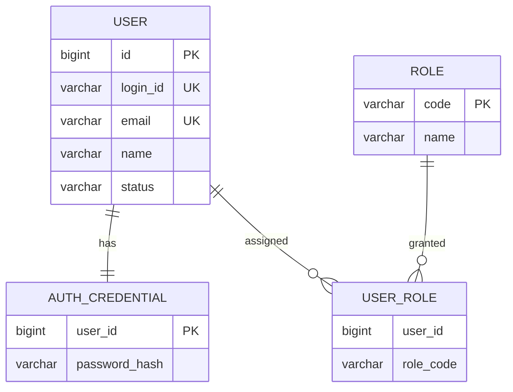

# 논리 DB 인계 및 소유권 (AA Draft)

정본: [Contract DB 설계/ERD](https://github.com/00700lsm/user-management-contract/blob/dev/docs/db-design.md). **실제 DDL/ORM 스키마를 여기에서 별도로 정본화하지 않습니다.**

| Entity | 논리 Owner | 핵심 필드/Key | 제약·정책 |
|---|---|---|---|
| USER | User (B) | id PK, login_id UK, email UK, name, status, created_at, updated_at | 중복 ID/이메일 불허, 상태값 ACTIVE/INACTIVE/WITHDRAWN, 탈퇴 Soft Delete |
| AUTH_CREDENTIAL | Auth (A) | user_id PK, password_hash, password_updated_at | 비밀번호 원문 저장 금지, USER.id 논리 참조 |
| ROLE | Permission (C) | code PK, name | 최소 USER/ADMIN 역할 |
| USER_ROLE | Permission (C) | user_id, role_code | 사용자/역할 논리 참조, (user_id, role_code) 유니크 |

## 소유 및 관계

이 관계는 **논리 개념도**입니다. 물리 분리 DB 간 FK 지원 또는 실제 FK 생성이 확정됐다는 뜻이 아닙니다.

## AA가 확정할 항목과 Backend에 위임할 항목

| AA/PL 합의 사항 | Backend 개발자가 설계할 사항 |
|---|---|
| Entity/Owner, Key/Unique, 핵심 상태값 | 실제 DBMS/마이그레이션/DDL SQL |
| 자격증명과 권한 데이터 소유 구분 | ORM 매핑, 컬럼 길이, 일반 인덱스 |
| 가입/탈퇴/상태 정책 | Repository/DAO/트랜잭션 코드 |
| 도메인 간 정합성/내부 API 결정 | 성능 튜닝, 세부 오류 복구 구현 |

DB 변경이 화면/API 필드나 도메인 계약에 영향을 주면 영향 분석 → 설계·계약 변경 PR → 테스트 순으로 진행합니다.
