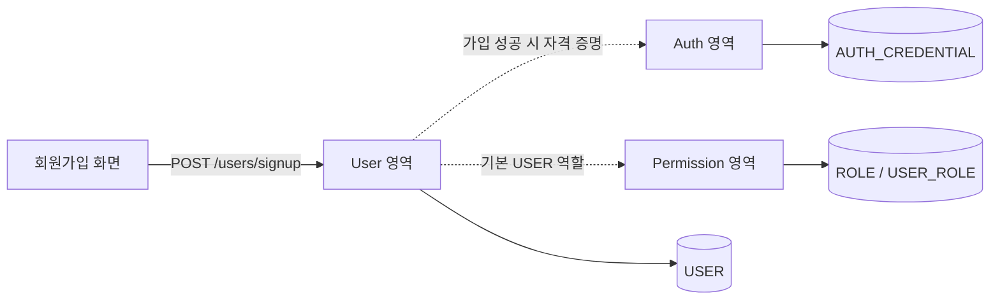

# Backend 기능·도메인 경계 (AA 인계, Draft)

공통 원칙: 외부 요청/응답은 [OpenAPI 정본](https://github.com/00700lsm/user-management-contract/blob/dev/openapi.yaml), 기능 완료 정의는 [요구사항](https://github.com/00700lsm/user-management-contract/blob/dev/docs/requirements.md) / [기능 명세](https://github.com/00700lsm/user-management-contract/blob/dev/docs/aa/functional-spec.md)를 따릅니다.

| 개발 담당 | 요구 ID | 기능 | 외부 API | 소유 데이터 |
|---|---|---|---|---|
| A Auth | REQ-AUTH-001~003 | 로그인·로그아웃·비밀번호 변경·인증/Token | POST /auth/login, /auth/logout, /auth/password/change | AUTH_CREDENTIAL |
| B User | REQ-USER-001~005 | 가입·프로필·관리자 목록/상세/수정/상태 | POST /users/signup, GET/PATCH /users/me, GET/POST /admin/users, GET/PATCH /admin/users/{id}, PATCH /admin/users/{id}/status | USER |
| C Permission | REQ-PERM-001~002 | Role 목록·사용자 역할 조회/교체 | GET /admin/roles, GET/PUT /admin/users/{id}/roles | ROLE, USER_ROLE |

## 도메인 경계
- **Auth**: 비밀번호 해시·인증 상태를 관리. User의 이름/이메일/상태를 직접 변경하지 않음. 인증 시 User 활성 상태·Permission 역할 확인 방식은 AA 결정 필요.
- **User**: 로그인 ID·이메일·이름·상태, 사용자 CRUD를 관리. 비밀번호 해시와 USER_ROLE을 임의로 직접 변경하지 않음.
- **Permission**: USER/ADMIN Role과 사용자별 역할 매핑을 관리. 사용자 프로필과 상태는 소유하지 않음.

## 연계 시나리오 (미확정 상호작용 명시)

위 점선은 **필요한 업무적 협업을 나타낼 뿐, 서비스 간 REST 내부 API나 실행 순서를 확정하지 않습니다.** 부분 실패/롤백/보상은 [DEC-002](https://github.com/00700lsm/user-management-contract/blob/dev/docs/aa/decisions.md)에서 결정해야 합니다.

## 공통 비즈니스 조건
- 관리자 API는 ADMIN 전용. 인증이 없으면 401, 권한이 부족하면 403 처리.
- 사용자 검색: 이름/이메일 OR, 상태 필터, `page` 0부터, `size` 기본 20/최대 100.
- 사용자 상태: ACTIVE/INACTIVE/WITHDRAWN. 물리 삭제 금지.
- Role: USER/ADMIN, 역할 교체 요청에 최소 1개/중복 없음.
- 표준 오류 JSON 구조는 OpenAPI `ApiError` 기준.

## 초기 결정 필요
- 인증 토큰 갱신/무효화 및 비활성 계정 처리
- User/Auth/Permission 가입 협업/트랜잭션
- 단일 모듈형 앱 vs 물리 서비스 3개, DB 격리 여부와 내부 통신 계약
- 관리자 사용자 생성 시 초기 비밀번호 정책

## 구현 변경의 기준
컴포넌트 내부 구현 변경은 담당 개발자 소관입니다. **서비스 경계/데이터 소유/API 계약이 바뀌면** Contract 저장소에 변경 제안하고, 승인 후 이 저장소의 구현에 반영합니다.
